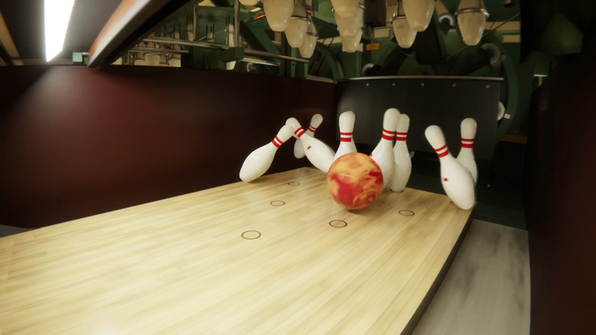

# Starlite Lanes — a first-person drone flight through a 1960s bowling alley, computed entirely by code

[](starlite_lanes_fpv.mp4)

One continuous 42-second shot. A cinewhoop-style quad drops out of a golden late-afternoon sky over a parking lot, flies in through
the open front door of *Starlite Lanes*, skims the snack bar, passes the jukebox and the house-ball racks, dives
over a scorer's table onto lane 6 as a ball comes through from behind, chases it down the lane, slides under the
masking unit as time slows to a crawl for the strike, hangs over the pit while the sweep clears the deck, tours the
automatic pinsetter (elevator wheel, distributor belt, turret, pin table), and leaves over the freshly set rack,
back up the lane for a last look at the house.

**No AI generation, photos, textures, 3D models, HDRIs, sound samples or off-the-shelf renderer were used.**
The picture is rendered by a path tracer written in this directory, the pins are knocked down by a rigid-body
simulation written in this directory, the sound is synthesised with numpy, and ffmpeg only encodes and muxes.

| Item | Value |
|---|---|
| Film | `starlite_lanes_fpv.mp4` — 1920×1080, 30 fps, 42.0 s (1260 frames), H.264 High yuv420p (BT.709) + AAC stereo 48 kHz; 56.8 MB, about 10.8 Mbps |
| Contact sheet | `contact_sheet.jpg` (one frame per second) |
| Source | `src/` — C++ / Objective-C++ host, one Metal compute kernel, Python for exposure, sound and QC |
| One-command rebuild | `./render.sh` (fixed seeds, resumable) |
| Reports | `qc_report.txt`, `audio_report.txt`, `audio_spectrogram.png` |
| Revision | second version; what changed after review is listed in section 8 |

## 1. The shot

| Video time | Where | What happens |
|---|---|---|
| 0–4.9 s | Parking lot → entrance | The hour before dusk: low sun behind the building's corner, gold horizon and lit cloud streaks, long shadows; the neon roof sign (STARLITE in pink, LANES in turquoise, a star and a pin), a dry lot with nine parked cars, palms, utility poles and low buildings in haze. Down under the canopy and through the propped-open glass doors |
| 4.9–9 s | Lobby, snack bar | Atomic-pattern carpet, sputnik chandeliers; along the counter over the chrome stools: burgers, milkshakes, ketchup and mustard, cola glasses, pie under a dome; behind it a tiled back bar with coffee urn, malt mixer, juice dispensers, toaster and register, back-lit menu board, SNACK BAR neon |
| 9–12 s | Jukebox, concourse | Past the glowing jukebox, onto the terrazzo concourse and over the racks of marbled house balls |
| 12–15.6 s | Settee, approach | Over the fibreglass benches and the scorer's table, under the overhead score screens, over the ball return; the ball is bowled from behind the camera |
| 15.6–17.7 s | Lane 6 | Chasing the ball 60 ft down the lane a foot above the boards (skid, hook into the pocket) |
| 17.7–22.8 s | Pin deck — bullet time | Time slows to 12 %, then 2 %: the hit, ten pins scattering, the ball ploughing through, while the drone keeps flying in real time round the deck and over the pit. 0.9 s of world time takes 5.1 s of film |
| 22.8–27 s | Pit | Time runs again: the ball thumps the pit cushion and rolls to its exit, the sweep drops and pushes the dead wood off the deck beneath the camera, the table brings the next rack down and sets it |
| 27–32 s | Inside the pinsetter | A look along the row of ten machines; pins riding up in the scoops of the elevator wheel, dropping onto the distributor belt, tipping base-first into the turret |
| 32–34.3 s | Out | Down behind the table, forward over the new rack, out under the pin-deck light |
| 34.3–42 s | Back up the lane | Rising over the lanes toward the lobby, then a half turn to face all ten lanes; fade |

The prompt's phrase "the unique perspective of a cat" was read as a leftover from another brief; the point of view
here is the drone's.

## 2. What makes it read as FPV footage

- **Lens**: stereographic fisheye, 114° horizontal, with a tiny aperture (0.9 mm radius, focus 2.5 m) so only things
  within a hand's width go soft; 180° shutter motion blur from real camera and object motion; lateral chromatic
  aberration, vignette, bloom, a little grain; lagging auto-exposure (metering pre-pass, then a causal filter that stops down
  faster than it opens up).
- **Flight** (`src/flight.h`): position/look keys through cubic Hermite, then low-passed (the drone has mass).
  Up to the lane (0–15 s) the path is smoothed hard (Gaussian, σ = 0.42 s) and the camera is not keyed at all: it
  looks at a point 0.95 s further along its own path, so there is no hunting from side to side. Over that stretch
  yaw never exceeds 23°/s and roll stays within ±1.4°. From the chase onward the hand-placed look targets take
  over and banking is stronger. Bank angle is never keyed: it comes from the lateral acceleration of the path
  (`atan(a/g)`, scaled down), with a little nose-down pitch from forward acceleration and slow attitude drift.
- **Bullet time** is a remap of video time onto world time (`RATE[]` in `flight.h`), not an edit: every animated
  thing (physics, machine, belts, lamps) is a function of world time, the camera is a function of video time, and the
  shutter interval is evaluated in both, so pins are sharp while the camera's own motion still blurs.
- No people. The reference project's lesson was that a procedural human reads as a dummy, so the house is empty and
  the ball is bowled from behind the lens.

## 3. The engine (all written for this film)

- **Host** `src/main.mm`: builds the world, the BVHs and a spatial light grid, uploads to Metal, evaluates every
  animated instance at shutter open and close, dispatches the kernel (8 passes × 2 samples), accumulates over time, denoises, applies the
  lens/film look on the CPU and writes PNG frames. Each frame is checked for a full sample count and re-rendered if
  the GPU dropped a pass.
- **Kernel** `src/render.metal`: a path tracer in one Metal compute function. Metal's ray-tracing API is not used.
  - Two-level BVH: binned-SAH static BVH over ~2.3 M triangles (large triangles pre-split), plus a small BVH over
    the ~40 animated instances rebuilt on the CPU each frame; hand-written stack traversal and Möller–Trumbore.
    Instances carry two rigid poses per frame and are interpolated per ray for motion blur.
  - Light transport: next-event estimation over 100 rectangle/sphere lights with multiple importance sampling
    against GGX/diffuse BSDF sampling; light selection is spatial (per-cell candidate lists) and lobe-aware, so a
    small lamp sitting in a glossy reflection is picked often enough to resolve. Neon tubes are emissive geometry
    seen directly and in reflections, with diffuse-only stand-in lights for the glow they throw. Three bounces,
    Russian roulette, thin glass, analytic indoor haze.
  - Sky and sun: an analytic golden-hour sky (blue zenith to rose and gold at the horizon by angle to the sun, a
    glow round the sun, streaky noise clouds lit from below). Outdoors the sun is sampled directly with one shadow
    ray into its disc, which gives the long soft-edged shadows; distance haze beyond 25 m.
  - Materials are procedural functions (no bitmap textures): lane boards with maple/pine splice, arrows, dots,
    pin spots and an oil pattern that changes the gloss; approach; atomic carpet; terrazzo with brass strips;
    checker tile; acoustic ceiling tile; walnut panelling; brick; dry patched asphalt with cracks, stall lines and oil stains; marbled balls with
    finger holes; scuffed pins with neck stripes; chipped machine paint; boomerang laminate; conveyor belts and
    chains that move with world time.
  - Denoiser, in three stages. (1) Temporal accumulation: every pixel is reprojected into the previous frame
    (through the fisheye, following moving pins and the ball by their own poses) and its diffuse and specular
    lighting are blended with that history, about 10 % new per frame once warm. History is accepted only where
    normal, plane, object and roughness agree, and is clamped to the range of the current frame's neighbourhood so
    stale light cannot ghost. Glossy reflections on flat surfaces are reprojected by where their mirror image is,
    not where the surface is, so highlights on the oiled lanes stay attached to the lights that cause them.
    (2) Spatial: the accumulated diffuse lighting, demodulated by albedo, goes through a variance-guided à-trous
    wavelet (normal / plane-distance / luminance stops); specular is filtered separately and more carefully.
    (3) A final reprojected anti-shimmer blend on the finished frame (neighbourhood-clamped), for sub-pixel
    detail such as distant gutters, palm fronds and ceiling tiles. Directly visible lamps, neon and sky bypass
    stages 1–2. The first frame of a run is preceded by 8 unsaved warm-up frames.
- **Signage** `src/atlas.h`, `src/world2.h`: a stroke font defined in code is rasterised into one atlas (masking-unit
  art, score sheets, menu board, posters, pennants, calendar, clock face, nameplates) and also bends the neon tubes.
- **Modelling** `src/mesh.h`, `src/world*.h`, `src/machine.h`: boxes with chamfered edges, lathes, tubes, tori,
  parametric surfaces and extrusions build everything — ten lanes with gutters, cappings and kickbacks; masking
  units with working pin-indicator lamps and a flashing strike light; ball returns and racks; settees, scorer's
  tables with projector heads, overhead score screens; snack bar with stools and everything on the counter; control
  desk with register and 75 shoe cubbies; jukebox; trophy case; gumball machines; sputnik chandeliers; the facade,
  canopy, roof sign, lot lamps; nine cars, sedans and wagons with and without fins (lofted bodies with wheel arches, glazed cabins with
  seats, dash and steering wheel, chrome bumpers and grilles, lamps, hubcaps — `src/world4.h`); palms, utility
  poles and wires, a street and low buildings; and ten pinsetters.
- **Physics** `src/physics.h`: ball and pins are rigid bodies (each pin a compound of ten spheres along its axis
  plus a base ring), sequential impulses with restitution and Coulomb friction at 4 kHz, against the deck, flat
  gutters, kickbacks, pit, cushion and the moving sweep. Entry line and angle are searched for a strike; the result
  is deterministic. Before the pins the ball follows a keyed skid-hook path with its spin integrated numerically.
- **Pinsetter** `src/machine.h`: the hero machine runs a full cycle off the physics clock — cushion swing from the
  ball's impact, sweep down/back/forward, table down with the next rack and up again, the wheel turning, pins
  queued into every other scoop, belt, tip into the turret, turret indexing.

## 4. Sound (all synthesised, `src/audio.py`)

The renderer exports a timeline (camera track, ball track, the time-rate curve, every impact in the simulation with
its strength and position, machine cue times) and the sound is built from it:

- No drone: the motors and prop wash of the first version were removed on request; the camera is silent.
- Outside: light wind, evening bird chirps, traffic rumble, neon buzz that grows near the sign. Inside: room tone, fluorescent hum.
- Jukebox: a small surf instrumental (Karplus–Strong guitar and bass, synthesised kick/snare/ride), band-limited
  like a console speaker, attenuated and low-passed by distance from the jukebox, muffled through the wall before the
  door, and slowed like a dragging record through bullet time.
- Ball: rumble generated in world time and warped onto video time; a thud as it lands behind the camera.
- Impacts: one grain per simulated contact (ball–pin, pin–pin, pin–deck/kickback, ball–cushion), scaled by impact
  speed and distance, stretched and pitched down by the local time rate; a sub-bass bloom on the hit; rising and
  falling sweeps where time bends.
- Pinsetter: motor runs and clunks on the sweep and table cues, pins dropping about once a second, hum/belt/chain
  bed that only exists near the machine. A synthetic hall reverb over the lot.

## 5. Process, timings and checks

Everything ran on one Apple M1 Pro.

| Step | Time | Notes |
|---|---|---|
| Metering pre-pass (320×180, 6 spp, every other frame) | about 2 min | feeds the exposure curve (multiplier 1.4–4.2 over the film) |
| Full render (1920×1080, 16 spp, 3 bounces, 1260 frames) | 154 min | 7.3 s per frame on average, 11.3 s at worst; no frame needed a retry for an incomplete sample count |
| Soundtrack synthesis | about 1 min | |
| Encode and mux | about 3 min | crf 19; with the lighter grain and steadier picture the file is about half the size of the first version |

- **The sweep board and the deck light.** As the sweep drops it passes through the beam of the pin-deck tube; a
  second tube behind the sweep's plane fades in only while the board is in the beam, so the deck does not go dark.
  This version was metered and rendered in one run with that in place.
- **Decode check** (`qc_report.txt`): 1260 frames decoded; 0 black frames outside the fades; 0 frozen frames;
  0 single-frame brightness flashes. The "single-frame block outlier" detector lists 17 candidates. I laid out the
  previous, current and next frame for all 17: every one is real content crossing a block in one frame (the door
  frame passing the lens, a pin in the pit, machine parts in fast pans, the deck light sliding out of frame), none
  is a rendering fault.
- **Shimmer** (`src/flicker.py`, frame-to-frame change of fine detail, in 8-bit levels, first version → this one).
  Second half of the film, where the flight is unchanged: wide lanes on the way back 5.9 → 2.9 typical and
  19.2 → 11.3 in the worst 5 % of blocks; last look at the house 5.8 → 3.0 and 17.6 → 12.6. First half (the flight
  differs, so this is indicative): lanes from the approach 5.5 → 2.8 and 16.0 → 9.7; snack bar 5.7 → 3.0 and
  25.0 → 18.7; lot 4.8 → 2.8 and 24.0 → 24.7 (the palms are new fine detail). The typical figure is mostly film
  grain, which was cut by more than half; the worst-blocks figure is the picture itself.
- **Contact sheet**: all 42 cells (one per second) were looked at.
- **Audio** (`audio_report.txt`): peak −1.1 dBFS, RMS about −18 dBFS, no clipped samples. Onset rises: the ball
  landing behind the camera +12.6 dB, the strike +8.6 dB, the ball into the cushion +4.3 dB, the table setting the
  rack +3.7 dB. Without the drone the lot (−29 dBFS) and the flight back up the lanes (−29 dBFS) are quiet.

## 6. Known shortcomings

- **Noise**: 16 samples per pixel plus the temporal and spatial denoiser. Still and slowly moving views are clean.
  What is left: surfaces that have just come into view have no history for a few frames, so fast pans inside the
  machine and edges of things whipping past the lens (the door frame, stools) show grain in the motion blur; the
  wire pin cages and chrome keep a little speckle; the picture is slightly softer than the first version.
- **Pin action is low**: the simulated pins scatter and tumble convincingly but stay close to the deck; real pins
  jump more. The sphere-chain collision shape also leaves millimetre gaps or overlaps at pin-to-pin contacts.
- **The pit hand-over**: a pin that passes under the cushion vanishes and reappears in a wheel scoop a moment
  later; the ball simply rolls into a housing. The transfer zone is mostly hidden but not entirely.
- **Lobby light is flat in places**, and the lane hall's troffers are plain rectangles. No light-dependent
  volumetrics: the haze is an ambient term, so there are no beams.
- **Machine paint chips and grease** are noise functions and look it at close range. The cars are far better than the first version's
  but still simplified: slab-sided bodies, no mirrors or wipers, plain interiors. Palms are ribbon
  fronds. The pit carpet's fleck pattern is heavier than a real one. Shoes are ellipsoids. The carpet has no pile geometry.
- **Flight feel**: banking is derived from the path, but there is no true thrust model, no prop guards in frame and
  no rolling-shutter wobble. The first 15 seconds are now deliberately smoother than most pilots would fly.
- **Sound** is all synthesiser timbre and would not be mistaken for a recording.

## 7. What was not verified

- Nobody, including me, has listened to the soundtrack. Only levels, a spectrogram and onset alignment were checked;
  that the drone is gone was confirmed from the synthesis code and the spectrogram, not by ear.
- The film has not been watched in continuous playback; it was checked as sampled frames (one per second, plus
  full-size frames of the lot, the snack bar, the lanes, the strike and the pit), consecutive-frame strips at the
  17 flagged places, the shimmer measurement and the automated bad-frame scan. Smoothness of the flight was judged
  from the camera track (yaw rate, roll), not from playback.
- Rendered on one machine (Apple M1 Pro). `render.sh` has not been run end to end from an empty directory.

## 8. Changes in the second version

| Review point | What was done |
|---|---|
| Cars looked like toys; the lot was bare | Nine rebuilt cars (sedans and wagons, glazed cabins with interiors, chrome, lamps, whitewalls), wheel stops, a hatched walkway, palms, poles and wires, a street, low buildings and hills |
| Bar and stools looked half-finished | New stools (bolted floor flange, chrome column and ribbed band, padded vinyl seat); counter with bull-nose edge, pleated vinyl front, kick plate and foot rail; tiled back bar with a glass shelf, equipment and an under-shelf light; more on the counter |
| Time of day | From dusk to the hour before it: analytic golden sky, directly sampled low sun, long shadows; lot lamps off |
| Drone sound | Removed |
| Swaying in the first half | 0–15 s re-keyed as one line, smoothed harder, camera looks along its own path; roll gain cut to about a third there |
| Ball and pins half buried after the strike (0:22–0:24) | A real modelling bug: the outdoor ground plane ran under the whole building 2 cm below deck level and hid the pit floor (10 cm down) and the gutter bottoms, so things resting there looked sunk. The ground is now laid round the building's footprint; the tail plank no longer overhangs the gutter ends; the pit has its own fill light |
| Noise and flicker in wide views | Temporal accumulation with mirror-image reprojection for the lanes, a final anti-shimmer pass, grain cut from 0.014 to 0.006 (figures in section 5) |

## Rendering it yourself

```bash
./render.sh
```

Requires macOS on Apple Silicon, Xcode command-line tools, Python 3 (numpy, scipy, Pillow) and ffmpeg.
